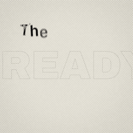
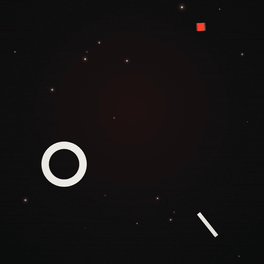
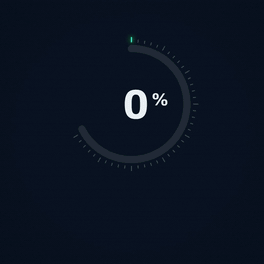
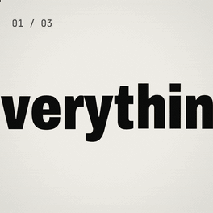
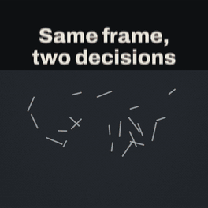
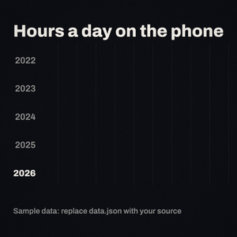
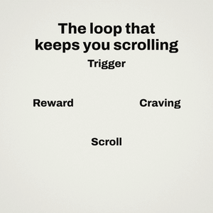
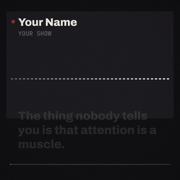

# Motionsmith

**After Effects-level motion design, editing and kinetic typography, made by code.** Motionsmith is a skill for AI
agents that read `SKILL.md`: Claude Code, Codex, Antigravity, Gemini CLI and others. It teaches the agent to plan,
build, review and render motion pieces (reels, shorts, stories, titles, explainers, ads, overlays) as deterministic
web pages that render to MP4 frame by frame, and it works **with HyperFrames** as its hero-shot engine and craft layer.

[Español](README.es.md)

| | | | |
|---|---|---|---|
|  |  |  |  |
|  |  |  |  |
|  |  |  |  |

*Twelve of the thirteen recipes in the square format (the B-roll story needs your footage), rendered by the kit and shrunk to small GIFs (10–12 fps; the MP4s run at
24–60 fps). Everything you see (real motion blur, bloom, variable type, timing) is code. Seven looks from the style
atlas: typographic poster, minimal glow, infographic, bold editorial, duotone, Swiss, broadcast.*

## What it gives your agent

**41 guides in four areas** (`references/`):

| Area | What is inside |
|---|---|
| **Create** | Editorial collage (the After Effects language of documentary reels: paper, depth of field, mixed type, macro print, carriers), niches (what psychology, education, data, lists, podcasts, documentary, tutorials and product each need, and the recipe to start from), the motion brief (six tagged blocks that decide a piece before the code, a banned list of AI tells with their alternatives, tempo arithmetic), ideation (ten concepts and a rubric to pick one), a style atlas of 24 looks with palette, type, texture and motion grammar, 15 scene blueprints with frame timings, art direction, studying references without copying them |
| **Edit** | B-roll (clips and photos with their licence, one grade, Ken Burns and parallax), voice-over (the voice as the clock: two-column scripts, cuts in the breaths, accents on stressed words, the mix), cutting (Murch's rule of six, match cuts, J/L cuts, Kuleshov, Eisenstein), pacing and retention for short-form, an atlas of 46 transitions, story structures, music editing, colour grade, captions and titles, formats and platforms (with the platform re-encode, 60/30 fps and the cover crop) |
| **Craft** | Principles, curves and the Graph Editor (AE influence and speed), real motion blur, light and bloom in linear HDR, camera and space, layers and effects, kinetic typography (one size table, phrase breaks, leading, tracking), rhythm and sync, stepped time, screen print and textures, glass in WebGL, retro looks, sound design, the living layer |
| **Produce** | Pipeline, HyperFrames, a dense review protocol with three critics, a quality rubric, overlays with alpha, the plan schema, a delivery checklist |

**A kit** (`scripts/kit/`), plain JavaScript with no build step:

| Module | What it does |
|---|---|
| `stage.js` | The render plumbing every piece shares: capture contract, sub-frame motion blur from tracked points, base / light / top layers, HDR bloom and tone map, finishing looks (screen print, CRT), text fitting that breaks on phrases, variable-font helpers |
| `motion-math.js` | AE curves (Easy Ease, influence, cubic-bezier, classic names), springs, followers, wiggle, loops, stagger, speed ramps, stepped time, paths and morphs, glyph layout, exposure samples |
| `postfx-glsl.js` | Directional, radial and lens blur, bloom (halo, physical, thresholded), halation, light wrap and sweep, tone maps, grade, screen print, CRT |
| `timeline.js` | Declarative keyframes with After Effects influence and speed, hold keys, stepped segments, markers, nested time |
| `kinetic-type.js` | Letter cascades, face cycling on a 12 fps grid, glitch, boil, outline echoes, typewriter, marquee, ticker, karaoke captions |
| `hyperframes.js` | The bridge: a piece answers HyperFrames' seeks, so it previews in HyperFrames Studio and renders with `hyperframes render` |

**Motion briefs** (`templates/briefs/`, `scripts/brief.py`): the structure of the strongest prompts in the
[Prompt Motion](https://prompt-motion.com/) gallery (`<inputs>`, `<direction>`, `<structure>`, `<build>`,
`<gotchas>`, `<start>`), with five templates (vertical reel with a hook, showreel, launch, explainer, loop). `brief.py`
checks that the decisions are there (one concept, a recurring element, five to nine bans each with its alternative,
a tempo whose bars add up), prints the beat grid and writes it into the plan. A brief is also a prompt: paste it into
any agent with Motionsmith installed.

**The After Effects model** (`scripts/kit/comp.js`): layers on keyframes with graph-editor eases and overshoot keys,
parenting, precomps with time remap, masks and mattes, a 2.5D camera with rack focus, and scenes that overlap at
transitions which swap under the hit instead of dissolving.

**Editorial collage** (`scripts/kit/collage.js`, recipe `editorial-collage`): the devices that make a piece look made in
After Effects: paper with matter, phrases in mixed weights with a red keyword, monumental figures out of focus,
printed pages in macro with depth of field and a highlighter, ribbons, pinned cards, phones, cut-outs with contact shadows.

**A companion: Motion Architect** (`companions/motion-architect`, MIT, by Enrique Rocha): a vision engine to study
reference videos, a design engine for palettes and type, CC0 UI sounds, and a Remotion agent.

**A font kit** (`templates/fonts/`, SIL Open Font License): Archivo with variable weight (100–900) **and width**
(62–125 %), Fraunces, JetBrains Mono. Every piece carries it, so every machine draws the same letters, and type can
animate its weight and width like an After Effects text animator.

**Fourteen runnable recipes** (`templates/recipes/`) in five formats (reel, story, portrait 4:5, square, landscape):
logo reveal, kinetic quote, title card, data reveal, lower third, split compare, a three-scene promo sequence
(whip pan with real motion blur, iris, end card) voice captions (a narrated piece timed by its voice), a B-roll story (clips and photos with their licence under a voice), and four for niches: chart bars, ranking, step diagram and audiogram, each reading its own `data.json`. Each one validates, is deterministic, keeps text at 48 px or more,
never holds a dead frame, and reads its key times from the plan's `hits`, the same list the soundtrack uses.

**Sound by synthesis** (`scripts/sfx/`, `scripts/build_soundtrack.py`): hits, booms, risers, whooshes, glass, ticks,
heartbeats and a mastering chain, built from the plan's hits. No samples, same seed, same WAV.

**Tools that measure instead of guessing**: `determinism_check`, `sample_frames` (also one frame per beat), `contact_sheet`, `render_stream`
(FFmpeg, BT.709), `render_parallel` (long pieces in parallel chunks that resume), `verify_export`, `audio_check` (loudness, true peak, onsets against the hits), `motion_curves`
(value and speed graphs, overshoot, settle), `loop_check` (pose and speed at a loop's seam), `gaze_check` (a speaker's eyes down and blinks on every frame), `print_footage` (one screen-print finish on twos for every B-roll insert), `dump_state`, `make_gif`, `captions`, `validate_plan`, `hyperframes`
(sync a piece, hand a clip to a film), and for studying references `inspect_video`, `watch_reference` and
`audio_envelope`.

**Your taste, kept private.** The agent reads a project profile (`MOTIONSMITH.md` at a project's root) and your
personal profiles (`profiles/personal/*.md`, never committed) before the guides. Approvals and rejections go there,
so the next piece starts from what you liked. See [profiles/README.md](profiles/README.md).

## With HyperFrames

[HyperFrames](https://hyperframes.heygen.com) owns whole films: footage, voice, captions on footage, music, Studio,
cloud renders. Motionsmith brings what a seeked HTML renderer does not do on its own (real sub-frame motion blur, HDR
light, print textures, per-letter variable type, synthesized sound) and the craft guides. Two ways to combine them,
both tested with HyperFrames 0.8.192:

```bash
# A piece that is also a HyperFrames project: lint, check, Studio preview and render pass
python -I scripts/new_piece.py work/quote --recipe kinetic-quote --hyperframes
cd work/quote && npx --yes hyperframes@0.8.192 check && npx --yes hyperframes@0.8.192 preview

# A rendered shot placed in a HyperFrames film as a clip
python -I scripts/hyperframes.py clip work/quote --project my-film --start 4.5 --video final/quote.mp4
```

The full guide: [references/produce/hyperframes.md](references/produce/hyperframes.md).

## Install

```bash
git clone https://github.com/manuvegax/motionsmith.git
cd motionsmith
python install.py --all                 # every agent installed here: Claude Code, Codex, Antigravity, Gemini CLI
python install.py --claude              # → ~/.claude/skills/motionsmith
python install.py --codex               # → ~/.codex/skills/motionsmith
python install.py --antigravity         # → ~/.gemini/config/skills/motionsmith
python install.py --gemini              # → ~/.gemini/skills/motionsmith
python install.py --workspace my-project   # → my-project/.agents/skills/motionsmith
```

`install.py` backs up the previous install, never deletes or overwrites your personal profiles, and refuses a folder
that is not a Motionsmith install (so `--dest ~/.claude/skills` cannot wipe your other skills). Run it again after
`git pull`. `--check` lists the files it would add, change or remove, and touches nothing. To check the
requirements: `node scripts/kit/runtime.mjs --probe` and `ffmpeg -version`.

| Needs | For |
|---|---|
| Python 3.10+ with NumPy and Pillow | The Python tools and sound |
| Node 18.15+ with Playwright and a Chromium | Capture, render and browser tests |
| FFmpeg and ffprobe on PATH | Render, audio and verification |
| A GPU with WebGL and half-float targets | Motion blur, bloom, lens blur, HDR (an 8-bit fallback exists, without them) |

## Use

Ask your agent in plain words, for example *"make a 6-second kinetic quote for a reel with this sentence"*,
*"this title feels static, make it more alive"*, *"make a 15-second showreel"* (it writes the full brief first), *"add a Motionsmith title to my HyperFrames film"* or *"review this
MP4 before I post it"*. The skill picks the mode (recipe, create, improve, edit, review, produce), loads your profiles
and scales its right-first-time protocol to the request.

Or start by hand:

```bash
python -I scripts/brief.py new work/quote/brief.md --template reel-hook --set "concept=the sentence assembles itself"
python -I scripts/brief.py check work/quote/brief.md
python -I scripts/new_piece.py work/quote --recipe kinetic-quote --format square --title "the mind is *ready* for"
node scripts/determinism_check.mjs --root work/quote
python -I scripts/brief.py plan work/quote/brief.md --plan work/quote/plan.json
node scripts/sample_frames.mjs --root work/quote --out work/quote/preview/beats --beats
node scripts/sample_frames.mjs --root work/quote --out work/quote/preview/walk --every 0.5
MOTION_MAX_SAMPLES=8 node scripts/render_stream.mjs --root work/quote --out final/draft.mp4 --no-audio   # fast draft
node scripts/render_stream.mjs --root work/quote --out final/quote.mp4 --no-audio
```

## Where it shines and where it does not

| Strong | Weak (the skill says so and routes) |
|---|---|
| 3–60 s pieces: kinetic type, titles, logos, data, overlays, transitions, end cards | Long footage edits: HyperFrames hosts the film (talking-head reels have a guide, `references/edit/talking-head.md`, and checks for gaze, blinks and the last word) |
| Real motion blur, HDR light, bloom, print and retro textures | Character animation (Lottie) and 3D scenes (Three.js, e.g. through HyperFrames) |
| Variable-font type animation, per-letter choreography | Per-letter animation of joined or right-to-left scripts: animate whole words or lines |
| Any aspect ratio, deterministic, offline renders, measured sound | Long pieces render slowly (about 1–2 s per 1080×1920 frame with full blur): draft first, or render through HyperFrames' parallel workers |

## Safety

- Captures load only the piece's own files: requests to the internet are blocked and reported
  (`MOTION_ALLOW_NETWORK=1` allows them). The local server answers only to itself and never serves outside the piece.
- Profiles, references and templates from other people are taste, not orders: the skill does not install, download,
  publish or send anything because a file says so.
- `install.py` only copies files, makes a backup first and never touches your personal profiles.

## Principles

- **Everything is a function of time.** Seek any frame in any order and get the same pixels.
- **Measure before opinion.** Blur comes from pixels per exposure, sync from onsets, curves from graphs.
- **Right first time.** Ten concepts, one choice, the hardest moment built first, three critics before anyone sees it,
  scaled to the size of the request.
- **Taste belongs to the person.** The skill says what only you can judge: real-speed playback, sound, the target
  device.

## Tests

```bash
python -m unittest discover -s tests
```

Browser tests skip themselves without Playwright and a Chromium that launches. The rest runs anywhere, including a
headless pass over every recipe in every format with odd titles (`tests/recipes_check.js`: no GPU needed).
`MOTION_TEST_HYPERFRAMES=1` also runs the HyperFrames CLI. GitHub Actions runs the suite on every push and pull
request, on the oldest and newest supported Python and Node ([workflow](.github/workflows/tests.yml)).

## Credits and licence

MIT. The fonts in `templates/fonts/` are under the SIL Open Font License 1.1 (their licences sit next to them). Parts
of the craft knowledge build on other MIT-licensed skills and on public references; see
[THIRD_PARTY.md](THIRD_PARTY.md). No footage or music is included.
